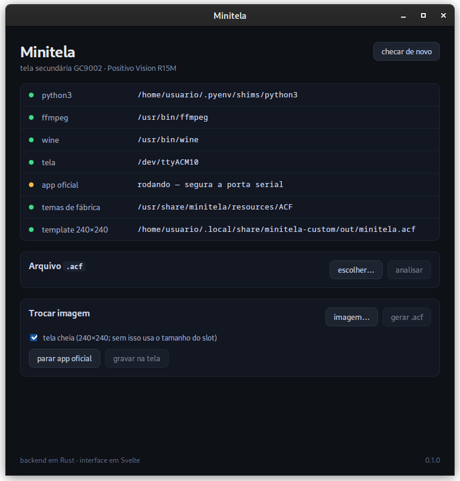

# App desktop (Tauri + Svelte)

Experimento em paralelo ao Python, **na branch `tauri`**. Nada aqui substitui as
ferramentas atuais: o Python continua sendo a referência e o que está testado no
hardware.

## Por que

O Python resolve o domínio (protocolo, `.acf`, codec, patch) e está validado. O que falta
é uma **UI de verdade** e distribuição sem depender de Python no host. O Tauri entrega as
duas coisas: backend em Rust e front em Svelte, com bundler que gera `.deb` / `.AppImage`.

## Estado

Hoje o app faz três coisas:

1. **ambiente** — o equivalente ao `minitela doctor`, em Rust:

- python3 / ffmpeg / wine no `PATH`
- `/dev/ttyACM*`
- app oficial rodando (varre `/proc/*/comm`)
- temas de fábrica em `/usr/share/minitela/resources/ACF`
- template em `~/.local/share/minitela-custom/out/minitela.acf`

2. **leitura/validação de `.acf`** — abre um arquivo e mostra tamanho, tela, páginas,
   texturas e o diagnóstico campo a campo (`CheckCode` por página, magic, versão);
3. **troca de imagem** — lista os três slots do `.acf` (páginas 4/5/6) com miniatura,
   deixa escolher imagem e **enquadramento por slot** (arrastar para recortar, zoom de
   1× a 3×, ou "conter" com barras), e gera um `.acf` novo com todas as trocas de uma vez,
   validando antes de escrever; a gravação já exibe a página do primeiro slot editado;
4. **tags em tempo real** — relógio, bateria, CPU e wifi, um round avulso ou um daemon de
   5 s (`sysinfo.rs` lê `/sys`, `/proc` e `iwgetid`; envio sem exigir ACK, como o Python);
5. **prévia da textura** — decodifica o slot e devolve PNG para a interface (antes e
   depois de gerar). Em arquivos oficiais aparecem artefatos: só o sub-formato de uma
   partição está implementado (issue #2);
6. **controle da tela** — assume a serial (para o app oficial se preciso), mantém a
   conexão com este app e troca página, brilho e as tags; "devolver ao app oficial"
   solta a porta e religa o app da Positivo. Num tty travado o `close()` prende a thread
   no kernel (estado D), então o descarte da porta acontece fora do lock;
7. **gravar na tela** — protocolo AHMI sobre a serial em Rust (`termios` puro via `nix`,
   sem `serialport`/`libudev`): handshake, troca para modo download, envio por páginas,
   fim e troca de página. Medido no hardware: **4,7 s** para o tema de fábrica.

O código do porte está em `src-tauri/src/acf/` (`codec.rs`, `inspect.rs`, `patch.rs`) e em
`src-tauri/src/device.rs`, validados contra os fixtures gerados pelo Python e no hardware.

## Como está hoje



Artefato do CI (AppImage compilado em `ubuntu-22.04`), rodando num Debian 12: o backend
Rust leu o ambiente e a interface listou cada item.

## Como rodar

```bash
cd apps/desktop
npm install
npm run tauri dev        # precisa das libs do webkit (ver abaixo)

npm run tauri build      # gera .deb/.AppImage em src-tauri/target/release/bundle
```

Dependências no Ubuntu:

```bash
sudo apt install libwebkit2gtk-4.1-dev libgtk-3-dev librsvg2-dev \
                 libayatana-appindicator3-dev patchelf libxdo-dev libssl-dev
```

## Estratégia do porte (quando decidirmos)

Ordem pensada para nunca ficar sem ferramenta que funciona:

1. **fixtures dourados** gerados pelo Python: os 22 `.acf` de fábrica, `gif75`, `anim8`,
   e as saídas de `acf_inspect --diagnostico` / `--fix`;
2. **`minitela-core` em Rust**: `acf_codec`, `acf_inspect`, `acf_anim`,
   `minitela_patch`, `minitela_ctl`, `minitela_tags` — cada um comparado byte a byte
   com o Python nos fixtures;
3. **CLI Rust** com o mesmo contrato (`minitela patch|inspect|tags|ctl|doctor`);
4. **UI**: diagnóstico (feito), depois patch com arrastar-e-soltar, preview do `.acf`
   decodificado, escolha de página e brilho;
5. **empacotar** com `tauri build`.

Fica de fora, de propósito:

- `minitela_build.py` (compilador do ODM sob wine) — continua externo;
- `lab/` e `tools/` (bancada e Ghidra);
- qualquer material do fabricante.

## Empacotamento: a glibc do runner vira o mínimo do usuário

O binário carrega a glibc da máquina que compila. Compilado em `ubuntu-latest` (24.04,
glibc 2.39), o AppImage **não abre** em Debian 12 (glibc 2.36) — o sintoma é
`GLIBC_2.38 not found`.

Por isso a pipeline usa **`ubuntu-22.04`** (glibc 2.35): o artefato roda em Debian 12,
Ubuntu 22.04 e mais novos. Se um dia precisar suportar distros mais antigas, é descer o
runner (ou usar container com glibc antiga), nunca subir.

## Regra de ouro

Nenhuma linha de Rust é considerada pronta sem passar nos fixtures. O Python é o oráculo:
se o Rust divergir, o Rust está errado até prova em contrário.
