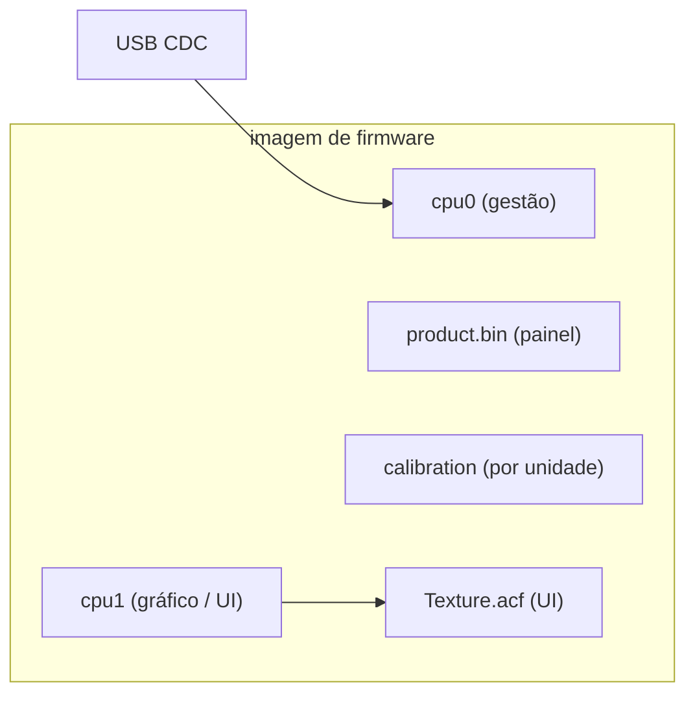

# Hardware

## O chip: GC9002

Não é um display burro: é um **SoC com GPU**, da fabricante chinesa Thorsianway
(速显微). O que se sabe de fonte pública e do próprio binário:

| | |
|---|---|
| GPU | **AHMI 3 Lite** (núcleo próprio da fabricante) |
| CPU | **XuanTie E902** (RISC-V, família E, `rv32emc`) |
| processo | 55 nm |
| cache de sistema | até 16 Mb |
| GPIO | 40 |
| interfaces | USB, SPI/QSPI, CAN, SD, UART… |
| telas suportadas | 100×100 até 1024×768 |

O firmware do firmware de gravação que analisamos foi compilado com
`GCC Xuantie-900 elf newlib V2.6.1`, `-march=rv32emc_xtheadse -mtune=e902` — confirma o
núcleo. O RTL do E902 é aberto ([opene902](https://github.com/XUANTIE-RV/opene902),
Apache-2.0); a GPU, o bootloader e o mapa de periféricos **não**.

## O módulo da minitela

| | |
|---|---|
| tela | 1,54", **240×240** |
| conexão com o notebook | USB CDC-ACM interno, `0324:0324` |
| stack USB | **CherryUSB** (open source, RISC-V) — visto no descritor |
| firmware | próprio: bootloader + aplicação (UI) + configuração |
| armazenamento | flash **NOR QSPI** de 4, 8, 16 ou 32 MB |
| driver do painel | **não documentado** (a EVB de 1,5" redonda usa ST77916 QSPI; não confirmado neste modelo) |

O descritor USB é genérico de propósito (`sxw-admin_CDC_DEMO`), então não espere string de
produto útil. A identificação do chip vem do toolchain e da documentação do fabricante.

## Como o firmware é organizado

O mapa da flash (ver [Mapa da flash](referencia/flash.md)) reflete a arquitetura que a
documentação da AHMI descreve:

- **cpu0** cuida da gestão e de parte do protocolo;
- **cpu1** é o runtime gráfico — desenha páginas e widgets e consome o `.acf`;
- **product.bin** descreve o painel; **calibration** é específica de cada unidade;
- **Texture.acf** é o que o usuário pode trocar (é o que este projeto faz).

O SDK do fabricante distribui `bootloader.bin`, `cpu1.bin`, `product.bin`, `upg_cfg.bin` e
`Texture.acf` de um painel de exemplo — não os da Policop.

## Ferramentas do fabricante

| ferramenta | plataforma | serve para |
|---|---|---|
| **AHMI IDE** | Windows | montar páginas e gerar o projeto |
| **AHMISimGen** (`AHMISimGenDemo_og.exe`) | Windows (PE32) | compilar projeto → `.acf` |
| **CDK** (`CDK-WINDOWS`) | Windows | compilar `cpu0`/`cpu1`/`bootloader` |
| SDK + chip support pack | Windows | BSP, exemplos, headers |
| `uartTool.exe` | Windows | gravar pelo protocolo serial |

O pacote `minitela` da Policorp traz o app Linux **e** o compilador de textura Windows — é
por isso que trocar imagem no Linux exige wine. Nós contornamos isso: ver
[GIF](referencia/gif.md) e [formato `.acf`](referencia/acf.md).

## O que não sabemos

- qual é a flash exata da sua unidade (só o firmware lê o JEDEC ID);
- o driver do painel deste modelo;
- se existe JTAG/SWD acessível na placa;
- o modo 1 do codec (duas partições).

São as frentes abertas em [Engenharia reversa](RE-acf.md) e boas ideias para contribuir.
