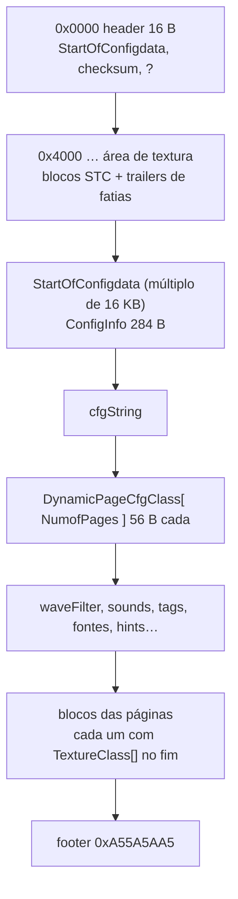

# Formato `.acf`

Um `Texture.acf` tem duas metades: **texturas** (os pixels) e **configuração** (páginas,
widgets, ações, fontes). O firmware valida a segunda com um checksum por página.

## Header

| offset | campo | observação |
|---|---|---|
| `0x00` | `StartOfConfigdata` | múltiplo de 16 KB |
| `0x04` | checksum | XOR de todas as words LE, exceto ele e a última; **não é validado** |
| `0x08` | `?` | medido: `TotalTextureSize / 2` |
| `0x0C` | projectID | string NUL-terminada, zero até `0x4000` |

## ConfigInfo (284 B, em `StartOfConfigdata`)

| offset | campo | valor esperado |
|---|---|---|
| +32 | `MagicNumber` | **`0x494d4841`** (`"AHMI"` em little-endian) |
| +36 | `TotalSize` | tamanho do arquivo − 8 |
| +40 | `TotalTextureSize` | inclui texturas **e trailers** |
| +44 | `DynamicPageSize` | tamanho da maior página |
| +72 | `CfgStringSize` | |
| +74 | `NumofPages` | |
| +260 | `AHMIInfo.Version` | **`0x5A010a13`** nesta versão |
| +264/266 | `ScreenWidth` / `ScreenHeight` | 240 × 240 |

!!! danger "O que o firmware valida"
    1. `StartOfConfigdata % 16384 == 0`
    2. `MagicNumber == 0x494d4841`
    3. `AHMIInfo.Version == 0x5A010a13`
    4. **`CheckCode` de cada página**

    Se o `CheckCode` divergir, o firmware entra num laço de leitura que **nunca termina** —
    é a tela travada clássica. O checksum do header (+4) ele ignora.

## Páginas

`DynamicPageCfgClass` (56 B) fica em `StartOfConfigdata + 284 + CfgStringSize`, uma após a
outra:

| offset | campo |
|---|---|
| 0 | `StoreOffset` (relativo a `StartOfConfigdata`) |
| 4 | `TotalSize` |
| 8 | `CheckCode` |
| 14 | `totalNumOfTexture` |
| 26 | `NumofGifWidget` |

`CheckCode = 0xA55A5AA5 ^ XOR(words do bloco)`, sobre os `TotalSize` bytes em
`StartOfConfigdata + StoreOffset`.

## Tabela de texturas

Dentro do bloco de cada página, depois das instruções de ação, vem `TextureClass[]` —
**48 B por registro**:

| offset | campo | notas |
|---|---|---|
| 0 | `SingleSliceSize` | bytes de **uma** fatia |
| 4 | `TexAddr` | offset no arquivo |
| 8 | `SliceFlagsHeaderAddr` | 0 = estática; ≠0 = trailer de fatias (GIF) |
| 12 | `mTexAttr` | bits 7–4 = tipo (ver [codec](codec.md)) |
| 16/18 | `TexWidth` / `TexHeight` | |
| 44 | `staticTexture` | 0 na prática |

`SingleSliceSize = ceil(w/4) × ceil(h/4) × 16`.

!!! tip "Como localizar a tabela sem parsear widgets"
    Ela fica no fim do bloco. O `acf_inspect.py` procura o offset que torna **todos** os
    registros coerentes (dimensões plausíveis, `slice == ceil(w/4)*ceil(h/4)*16`, endereço
    dentro do arquivo).

## Detalhe que confunde: dois "AHMI"

| constante | bytes | onde |
|---|---|---|
| `0x494d4841` | `41 48 4d 49` (`"AHMI"`) | ConfigInfo+32, do `.acf` |
| `0x41484D49` | `49 4d 48 41` (`"IMHA"`) | `upg_cfg.bin`, mesmo texto com byte-order trocado |

Provas, tabelas medidas e o roteiro para gerar um `.acf` do zero:
[`RE-acf.md`](../RE-acf.md) e [`RE-acf-source.md`](../RE-acf-source.md).
