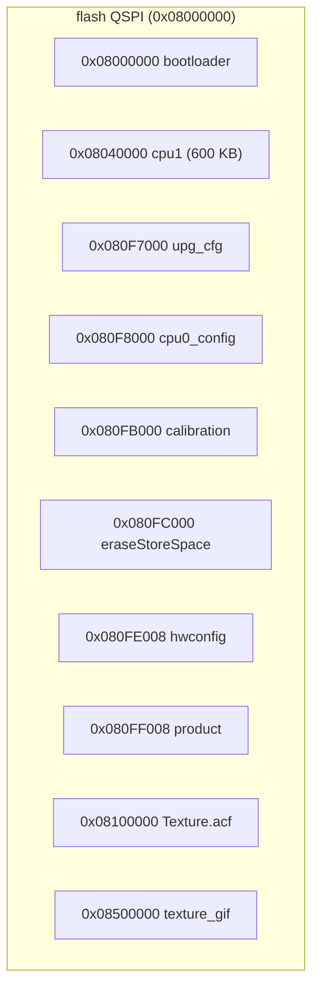

# Mapa da flash

A flash é uma **NOR QSPI mapeada em `0x08000000`** — o firmware lê o conteúdo com *loads*
normais (XIP), não com comandos de leitura. A controladora fica em `0x40100000`
(`CQSPI_DATA_BASE` = `0x08000000`, `base` = `0x40100000`).

| endereço | região | o que é | podemos gravar? |
|---|---|---|---|
| `0x08000000` | bootloader | inicialização | **não** — brick sem recuperação |
| `0x08040000` | cpu1 (600 KB) | firmware gráfico (runtime da UI) | não — sem backup no pacote |
| `0x080F7000` | upg_cfg | config do modo de upgrade | não |
| `0x080F8000` | cpu0_config | config do núcleo de gestão | não |
| `0x080FB000` | calibration | calibração do painel, **por unidade** | **nunca** — não há como restaurar |
| `0x080FC000` | eraseStoreSpace | área de armazenamento | não |
| `0x080FE008` | hwconfig | config de hardware | não |
| `0x080FF008` | product | config de produto/exibição | não |
| `0x08100000` | **texture** | o `Texture.acf` | **sim** — é o nosso caminho |
| `0x08500000` | texture_gif | área de GIFs | não usado por nós |

O `minitela_ctl.py` recusa as regiões críticas (`BLOCKED`) antes de abrir a porta.

## Tamanho da partição de textura

Depende da flash, identificada por JEDEC ID no boot:

| flash | tamanho | partição |
|---|---|---|
| `0x164020` | 4 MB | **3 MB** |
| `0x17405E` / `0x174020` | 8 MB | **7 MB** |
| `0x184020` / `0x18405E` | 16 MB | **15 MB** |
| `0x1940C8` (GD25Q257D) | 32 MB | 31 MB |

Daí o comentário "3M/7M/15M" no app da Policorp. Na prática: um `.acf` de 5,16 MB (GIF de
75 quadros) só cabe se a sua flash for de 8 MB ou mais. Não há como consultar o tamanho
pelo protocolo.

## Como se grava

- apagar é por **setor de 4 KB**; escrever é *page program*;
- o driver **trunca o endereço de erase em 4 KB** (`addr & 0xFFFFF000`) e apaga
  `ceil(n/4096)` setores — por isso gravar um `.acf` menor sobre um maior deixa resíduo;
- a geometria (setor/bloco/página/opcodes) vem da **SFDP em runtime**, não de uma tabela
  fixa de fabricante.

## Curiosidades que fecham dúvidas

- **CRC32 em `0x40108000`**: existe no chip, mas o firmware analisado não usa.
- `flashChecksum` do SDK é um **stub** (`return 0`): nem o caminho de gravação do
  fabricante valida checksum.
- o checksum do `.acf` (campo `+4`) é XOR de words e **não é validado** pelo firmware.

Provas, símbolos e endereços de código: [`RE-firmware.md`](../RE-firmware.md).
