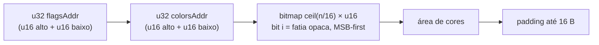

# GIF: fatias e trailer

O firmware **não** tem textura de GIF. Ele tem **fatias**: um único `TextureClass` com
`N` quadros do mesmo tamanho, e um widget que avança o índice.

```
TextureClass (a mesma das imagens estáticas)
  SingleSliceSize = S          bytes de um quadro (240×240 RGBA = 57.600)
  TexAddr                       onde começa o quadro 0
  SliceFlagsHeaderAddr != 0     trailer de fatias, logo depois do último quadro
  mTexAttr                      tipo (0x10)
```

Quadro *i* fica em `TexAddr + i × S`, em ordem, sem alinhamento entre eles.

## Quem manda animar

No bloco da página, nas variáveis do widget (`u16` cada), a partir de `bloco + 0x178`:

| offset | variável | valor medido |
|---|---|---|
| `+0x178` | `GifNowTime` | 0 |
| `+0x17A` | `GifInterval` | 100 (≈ 120 ms por quadro) |
| `+0x17C` | `GifNowIdx` | 0 — índice atual, que vira `FocusedSlice` |
| `+0x17E` | **`GifSliceNum`** | número de quadros |
| `+0x180` | `GifID` | 0 |

O firmware avança a cada `ceil(GifInterval / 30)` ticks de 30 ms. O widget precisa estar na
lista `gifWidgetList` da página (`NumofGifWidget > 0`) — nas páginas 4/5/6 do projeto da
minitela já está.

## Trailer de fatias



- tamanho: `align16(8 + 2 × ceil(n/16))` — 16 B até 8 quadros, 32 B até 96;
- `flagsAddr` = início do trailer + 8; `colorsAddr` = depois do bitmap;
- bitmap **MSB-first dentro de cada `u16`**: quadro 0 = bit 15 do primeiro u16.

## O que muda no arquivo quando N cresce

Como os quadros entram no meio da área de textura, tudo depois anda
`d = (N−1) × S + trailer_novo − trailer_velho`:

1. as texturas seguintes são **relocadas** e seus `TexAddr` corrigidos;
2. `StartOfConfigdata` passa para o próximo múltiplo de 16 KB;
3. `TotalSize` (+36), `TotalTextureSize` (+40) e o campo `@8` (`= TotalTextureSize/2`)
   são atualizados;
4. o `CheckCode` de **toda** página cujo bloco mudou é recalculado (o registro do slot e
   os relocados mudam bytes);
5. por último o checksum do header (+4).

O `acf_anim.py` faz exatamente isso e o `minitela_patch.py` valida o resultado com o
`acf_inspect.py` antes de gravar.

## Limites

| item | valor |
|---|---|
| quadros | 96 (tamanho do trailer) |
| memória | o arquivo precisa caber na partição de textura (3/7/15 MB) |
| compressão | **nenhuma**: os quadros são STC cru. O `gziplib` existe no SDK, mas está desativado (`USE_GZIP_LIB` comentado) |

Validação da receita: reconstruímos o `.acf` de 75 quadros do compilador do fabricante a
partir do estático + os quadros, com **10 bytes divergentes** — todos padding/lixo do
gerador ou checksums derivados. Detalhe em
[`RE-acf-source.md`](../RE-acf-source.md#7-gif-animado).
