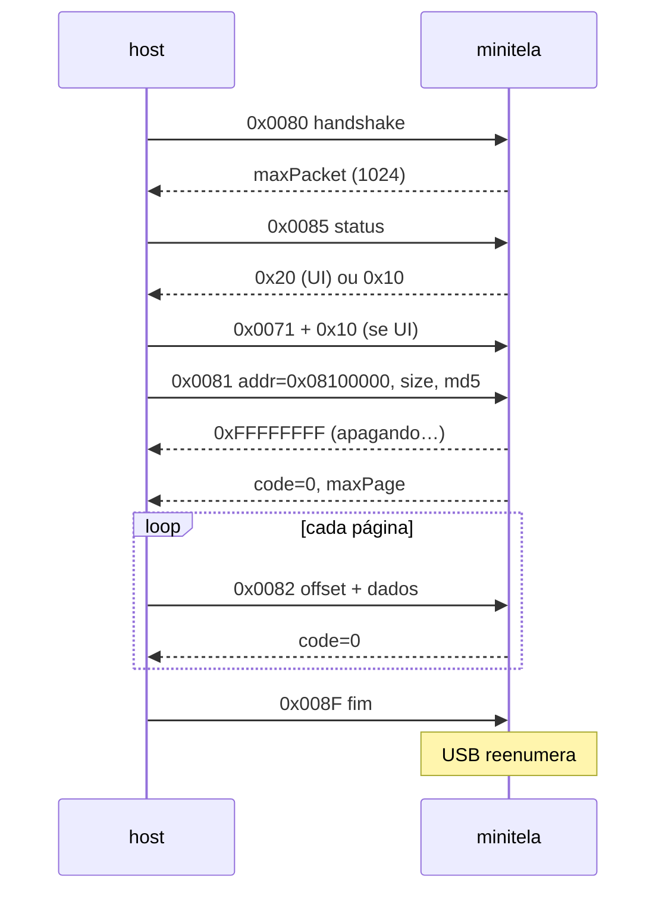

# Protocolo AHMI

Tudo o que o host manda para a minitela é um frame `AH … MI` sobre o CDC-ACM
(`/dev/ttyACM*`, `0324:0324`). O firmware responde no mesmo formato.

## Frame

```
AH (2) │ CTRL (2) │ CMD (2) │ conteúdo (n) │ CRC (2) │ MI (2)
```

| campo | regra |
|---|---|
| `AH` / `MI` | fixos (`0x4148`, `0x4D49`) |
| `CTRL` | tamanho do que vem depois dele até o CRC; bit 15 = habilita CRC |
| `CMD` | comando; a resposta é sempre `CMD + 0x40` |
| `CRC` | só existe se o bit 15 do `CTRL` estiver ligado; senão `0x0000` |

O app oficial **nunca liga o CRC**, e o firmware o ignora. Nossos frames fazem igual.
Tamanho máximo de frame: **1048 B** (o handshake devolve `maxPacketLength`, medido: 1024
de dados).

## Comandos

| CMD | resposta | nome | conteúdo |
|---|---|---|---|
| `0x0080` | `0x00C0` | handshake | vazio → `maxPacketLength` (u32) |
| `0x0070` | `0x00B0` | reboot | vazio |
| `0x0071` | `0x00B1` | trocar estado | `0x10` = modo download |
| `0x0081` | `0x00C1` | request download | `addr(u32) size(u32) md5(16)` → `maxPage(u32) code(u32)` |
| `0x0082` | `0x00C2` | data download | `offset(u32) + dados` → `code(u32)` |
| `0x0083` | `0x00C3`* | **upload/leitura** | `addr(u32) size(u32)` — **não implementado** no firmware da minitela |
| `0x0085` | `0x00C5` | status do download | vazio → `status(u8) fileId(md5) offset(u32)` |
| `0x0086` | `0x00C6` | offset atual | vazio → `offset(u32)` |
| `0x008F` | `0x00CF` | fim do download | vazio |
| `0x0090` | `0x00D0` | escrever registradores | ver [tags](tags.md) |

\* código deduzido do padrão `CMD + 0x40`; não confirmado, porque o comando não responde.

!!! warning "`0x0083` não existe na minitela"
    Ele está documentado na planilha oficial (`GC9002串口升级协议`) e definido no fonte do
    bootloader do SDK — **sem handler**. Testamos no hardware, com a tela saudável e com a
    tela travada: nenhuma resposta. Não há como ler a flash por protocolo; só SWD/JTAG.

## Estados do download

`status` devolvido por `0x0085`:

| valor | significado |
|---|---|
| `0x10` | preparando download (estado normal logo após o boot) |
| `0x11` | em download |
| `0x20` | rodando a UI (AHMI) |

Fluxo para gravar um `.acf` (o que o `minitela_ctl.py send` faz):



Detalhes que custaram tentativa:

- `0x00C1` pode vir **duas vezes**: primeiro `0xFFFFFFFF` ("apagando a flash"), depois
  `code=0`. É preciso continuar lendo, não só esperar o primeiro frame.
- o firmware **reenumera o USB** ao terminar; o fd antigo morre com `EIO`. Reabra a porta
  antes de mandar o próximo comando (é o que o `--page` faz).
- o CRC do `.acf` **não** é validado pelo firmware, mas o `CheckCode` de cada página é —
  e se estiver errado o laço de leitura não termina (ver [formato ACF](acf.md)).

## Bootloader: outro mundo

O bootloader do GC9002 (o que roda na janela de boot) implementa **quatro** comandos, sobre
**UART** (não USB): `0x0080`, `0x0081`, `0x0082`, `0x008F`. A janela é de **500 ms** após o
reset, em UART2 (`PB9`/`PB8`, 115200); sem um handshake válido, ele salta para o app.
Não há flag, GPIO nem comando de reset para entrar nele — é só a janela.

Provas e endereços: [`RE-firmware.md`](../RE-firmware.md).

## Tags em tempo real

Os registradores vão por `0x0090`, em dois formatos:

```
texto:  AH │ ctrl │ 0090 │ 0xD0 │ regId(2,BE) │ tamanho(2,BE) │ UTF-8 │ crc │ MI
número: AH │ ctrl │ 0090 │ 0x8N │ [regId(2,BE) valor(4,BE)] × (N+1) │ crc │ MI
```

Até **16 tags** por frame. O mapa de ids e telas está em [Tags e IDs](tags.md).
